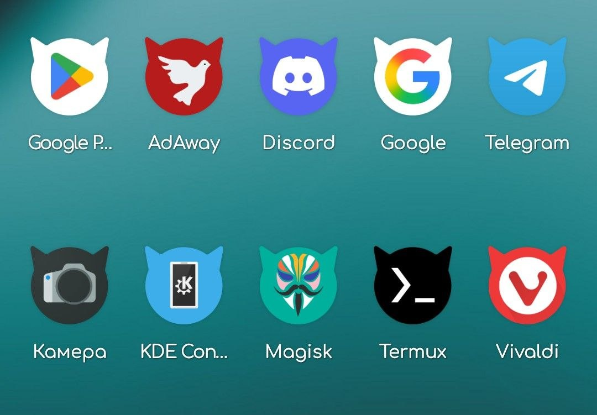

# Meow (cat-ears) icon shape Magisk module
## Android 10+ only! AOSP ROMs only (e.g. LineageOS, crDroid)! Do not install on non-AOSP ROMs (MIUI, OneUI, etc.)!

It overrides the system `android:string/config_icon_mask` via a lightweight Runtime Resource Overlay (`MeowIconShapeOverlay.apk` in `/system/product/overlay/`), and during installation automatically resets the launcher's Wallpaper & Style shape override (`*.grid_control`) so the home screen also renders cat-ears.

Download latest [release](https://github.com/ImMALWARE/meow-icon-shape-magisk/releases/latest) and install it via Magisk app. After reboot, the cat-ears icon shape should be applied to home screen, menu, and settings.

